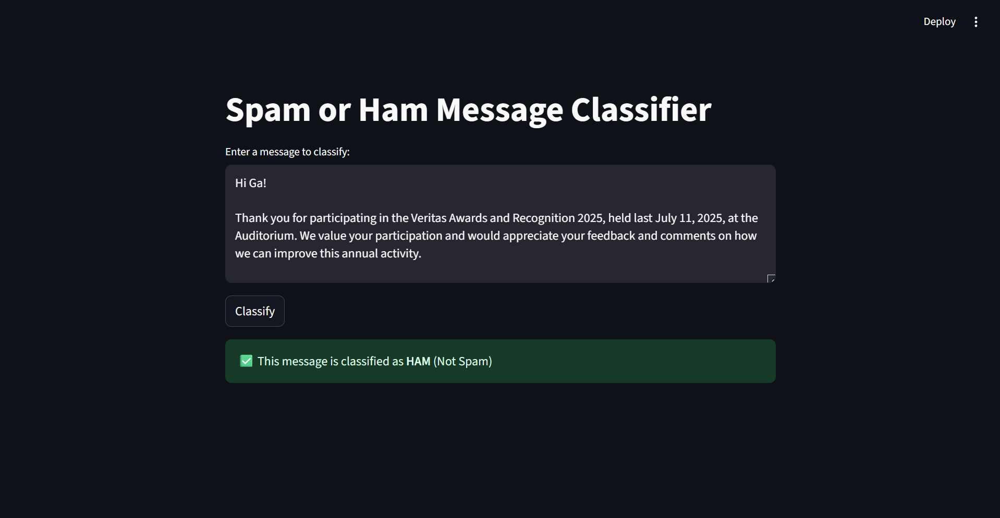
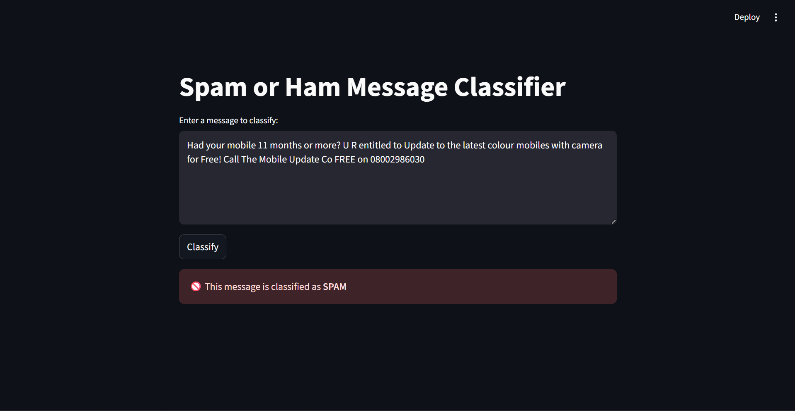

# SPAM CLASSIFICATION APP

## 📄 App Description

This Streamlit app is a simple Spam vs Ham (Not Spam) message classifier. It uses a Naive Bayes machine learning model trained on the popular SMS Spam Collection dataset from Kaggle. Users can input any message, and the app will predict whether it's spam or not in real-time.

## ⚙️ Setup Instructions

1. Clone or download the app

    Keep `spam.csv` in the project root.

2. Install the app and notebook dependencies

    Run the following command in your terminal:

        pip install -r requirements.txt

3. Train or retrain the model (optional)

    Open `train_model.ipynb` in VS Code or Jupyter and run all cells. The notebook preprocesses `spam.csv`, trains the classifier, and saves it to `artifacts/spam_classifier.pkl`.

    The generated model artifact is included, so this step is only needed to retrain the model.

4. Run the app

    In your terminal, navigate to the directory containing your script and run:

        streamlit run app.py

5. Interact

    A browser window will open.

    Enter a message into the text area.

    Click "Classify" to see whether the message is SPAM or HAM.

## Project Structure

    app.py                  Streamlit user interface
    train_model.ipynb       Data preprocessing and model training
    artifacts/              Trained model used by the app
    spam.csv                Training dataset

## Screenshots

### HAM: 

### SPAM:

